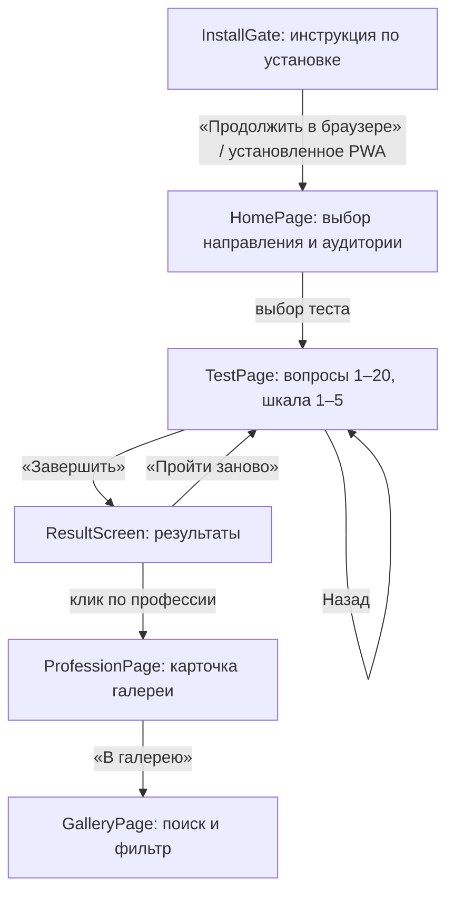

# Архитектура и интерфейс PWA «ПГУ: Экономика — твой выбор»

**Дата:** 2026-10-15
**Основание:** `docs/project-analysis.md` (требования MVP), `TECH_STACK_PGU_Economics_PWA.md`.
**Назначение документа:** зафиксировать архитектуру приложения, формат данных, навигацию и дизайн-решения. Документ соответствует фактически реализованному коду в ветке `feat/pwa-mvp`.

## 1. Ограничения и принципы

- **Только клиент**: без backend, базы данных, авторизации и админ-панели. Все данные (тесты, профессии, прогресс) — статические файлы и `localStorage`.
- Один пользователь — одно устройство: прогресс теста хранится локально, без синхронизации.
- Мобильный опыт первичен: тач-цели ≥ 44 px (`min-h-11`), отсутствие горизонтального скролла при ширине 320 px.
- Доступность: клавиатурная навигация, видимый фокус (`focus-visible`), `prefers-reduced-motion` (`motion-safe:`), aria-атрибуты на интерактивных элементах.

## 2. Технологический стек

| Слой | Технология | Обоснование |
|---|---|---|
| UI | React 18 + TypeScript | Стабильная база, строгая типизация данных тестов |
| Сборка | Vite 6 | Быстрая сборка, нативная поддержка PWA-плагина |
| Стили | Tailwind CSS v4 | Утилитарные стили без отдельного CSS-слоя; дизайн-токены через классы |
| PWA | `vite-plugin-pwa` (Workbox, `generateSW`) | Манифест + service worker + precache без ручного кода SW |
| Юнит-тесты | Vitest 3 + Testing Library (jsdom) | Совместимо с Vite 6 |
| E2E | Playwright (Chromium, `vite preview` на `127.0.0.1`) | Проверка флоу, офлайна, адаптивности |

## 3. Структура каталогов

```
pwaproject/
├── index.html                  # точка входа, lang="ru"
├── vite.config.ts              # плагины + манифест PWA + конфиг vitest
├── playwright.config.ts        # e2e: preview-сервер на 127.0.0.1:4173
├── public/
│   └── icons/                  # icon.svg (any), icon-maskable.svg (maskable)
├── src/
│   ├── main.tsx                # createRoot + StrictMode
│   ├── App.tsx                 # корневой компонент, переключение экранов
│   ├── components/             # переиспользуемые UI-компоненты
│   │   ├── AppShell.tsx        # каркас: шапка + <main> (max-w-xl)
│   │   ├── InstallGate.tsx     # экран инструкции по установке
│   │   ├── TestCard.tsx        # карточка теста на главной
│   │   ├── ProgressBar.tsx     # role="progressbar", «N / 20»
│   │   ├── QuestionScreen.tsx  # вопрос + шкала 1–5 + «Назад/Далее»
│   │   └── ResultScreen.tsx    # результат: топ-3, лучший/худший, переходы в галерею
│   ├── pages/
│   │   ├── HomePage.tsx        # выбор направления и аудитории, список тестов
│   │   ├── TestPage.tsx        # прохождение теста, состояние, подсчёт
│   │   ├── GalleryPage.tsx     # галерея профессий: поиск + фильтр по программам
│   │   ├── ProfessionPage.tsx  # карточка профессии (описание, обязанности, навыки)
│   │   ├── DirectionsPage.tsx  # направления подготовки (4 программы)
│   │   ├── ProgramPage.tsx     # карточка программы + связанные профессии
│   │   └── ClubPage.tsx        # клуб молодого предпринимателя
│   ├── lib/
│   │   ├── scoring.ts          # scoreTest, getResultExtremes (чистые функции)
│   │   ├── storage.ts          # loadProgress / saveProgress / clearProgress
│   │   └── pwa.ts              # isStandalone (guard для окружений без matchMedia)
│   ├── data/                   # контент, редактируется без изменения кода
│   │   ├── directions.json     # направления подготовки
│   │   ├── programs.json       # 4 программы подготовки (разделы — заглушки)
│   │   ├── professions.json    # 10 профессий (id, programId, title, description)
│   │   ├── professionDetails.json # карточки галереи: задачи и навыки / зарплата в ЕАО / карьера
│   │   └── tests.json          # вопросы с весами + тесты (см. п. 5)
│   └── types/
│       └── test.ts             # Audience, Question, CareerTest, Profession…
└── tests/                      # vitest (*.test) + playwright (*.spec)
```

## 4. Навигация

Приложение — одностраничное; роутер не используется. Навигация — конечный автомат состояния в `App.tsx` и верхнее меню из 4 разделов (Тесты, Галерея профессий, Направления, Клуб):

```ts
type View =
  | { name: "home" }
  | { name: "test"; testId: string }
  | { name: "club" }
  | { name: "gallery" }
  | { name: "profession"; professionId: string }
  | { name: "directions" }
  | { name: "program"; programId: string };
```



Ключевые решения:

- `TestPage` получает `key={test.id}` — при переключении теста состояние сбрасывается полностью.
- Экран установки (`InstallGate`) показывается только в браузерном режиме (`isStandalone() === false`) и закрывается кнопкой «Продолжить в браузере»; в установленном PWA контент открывается сразу.
- Прогресс: ответ сохраняется сразу при выборе варианта; переход «Далее» на последнем вопросе удаляет прогресс из `localStorage` и показывает результат. Перезагрузка страницы возвращает пользователя к текущему вопросу с сохранёнными ответами.

## 5. Формат JSON

Три файла в `src/data/`. Идентификаторы — строковые, ссылочная целостность проверяется юнит-тестом `tests/data.test.ts`.

**`directions.json`** — направления подготовки:

```json
[
  {
    "id": "economics",
    "title": "Экономика",
    "programs": [
      "Экономика 38.03.01, бакалавриат (Финансы и кредит)",
      "…"
    ]
  }
]
```

**`professions.json`** — 10 профессий направления с привязкой к программам:

```json
[
  { "id": "accountant", "directionId": "economics", "programId": "econ_accounting", "title": "Бухгалтер", "description": "Ведёт учёт финансовых операций компании…" }
]
```

**`programs.json`** — 4 программы подготовки (38.02.07, 38.02.01, 38.03.01, 38.04.01), наполнены данными с официальных страниц ПГУ, ООП и учебных планов: срок и формы обучения (`durationByForm` — срок по каждой форме), стоимость (`costPerYearByForm` — по каждой форме), места и проходной балл по профилям (`profileDetails[].forms` — форма обучения профиля, если она единственная, напр. ЭБиУР магистратуры — только заочно), вступительные испытания, описание, дисциплины (из учебных планов 2026 набора), компетенции (тексты без кодов УК/ОПК/ПК/ОК; у профилей магистратуры — в `profileDetails[].competencies`; у бакалавриата — УК/ОПК из ФГОС + ПК профиля, устанавливаемые программой), карьерные перспективы, дополнительные сведения о квалификации (`qualificationDetails` — из учебного плана: практики, курсовые, ГИА), руководитель, партнёры, ссылка на официальный источник (`sourceUrl`). Разделы, отсутствующие в источнике, перечислены в `pending` и отображаются как «готовится» — данные не выдумываются.

**`professionDetails.json`** — секции карточки профессии: `tasksAndSkills` (задачи и навыки), `salary` (заработная плата в ЕАО), `career` (карьера); источник — «Галерея профессий.docx», все секции заполнены. Описание профессии хранится в `professions.json` (там же обновлено по документу); блок «Связь с программами в ПГУ им. Шолом-Алейхема» строится из связи `profession.programId` → программа.

**`tests.json`** — вопросы и тесты (единый файл, вопросы переиспользуются):

```json
{
  "questions": [
    {
      "id": "q01",
      "text": "Мне нравится работать с цифрами…",
      "weights": { "accountant": 3, "financial_analyst": 2, "tax_consultant": 1, "insurance_agent": -2, "business_analyst": -1, "economist": 1 }
    }
  ],
  "tests": [
    {
      "id": "school-economics-v1",
      "directionId": "economics",
      "audience": "school",
      "title": "Тест для школьников",
      "questionIds": ["q01", "… 20 шт."]
    },
    {
      "id": "spo-bachelor-economics-v1",
      "audience": "college_or_bachelor",
      "…": "тот же формат, другая выборка вопросов"
    }
  ]
}
```

Схема подсчёта: ответ — оценка 1–5; балл профессии за вопрос — `w × (a − 3)`, где `w` — знаковый вес. Процент — нормировка к достижимому диапазону (`(raw − min) / (max − min) × 100`, 50 — нейтрально); пропущенный вопрос исключается из raw, min и max. Правила вывода весов — `docs/scoring-methodology.md`.

## 6. Модель состояния

| Данные | Где хранятся | Формат |
|---|---|---|
| Тесты, вопросы, профессии | `src/data/*.json`, импорт при сборке | Иммутабельные константы |
| Прогресс теста | `localStorage`, ключ `pgu-econ-progress-v2` | `{ testId, answers (1–5), currentIndex, updatedAt }` |
| Результат | Только в памяти (`ResultScreen`) | `ScoredProfession[]` — не сохраняется |

`storage.ts` оборачивает все обращения к `localStorage` в try/catch: в приватном режиме или при переполнении приложение продолжает работать без прогресса. Прочитанное значение валидируется (`isValidProgress`); повреждённые данные или прогресс другого теста игнорируются.

Подсчёт результата (`scoring.ts`) — чистая функция без побочных эффектов: тестируется изолированно и переиспользуется при изменении UI.

## 7. Дизайн

Стиль — современный образовательный: светлый, спокойный, контентный.

- **Каркас**: колонка `max-w-xl` по центру на фоне `slate-50`; шапка с брендом ПГУ (`bg-white`, нижняя граница `slate-200`).
- **Цвет**: акцент — `sky-600` (основные кнопки, выбранные варианты, прогресс); фон карточек — `white`, рамки — `slate-200`; вторичный текст — `slate-500/600`. Тёплая плашка `amber` — метка «есть прогресс».
- **Типографика**: системный шрифт; заголовки экранов `text-xl font-semibold`, текст вопроса `text-lg`, вспомогательные подписи `text-sm`.
- **Компоненты**: скруглённые карточки (`rounded-xl`/`rounded-lg`) с тонкими рамками и мягкими тенями; интерактивные варианты ответов — полноширинные кнопки с `aria-pressed`, выбранное состояние — `border-sky-600 bg-sky-50`.
- **Микровзаимодействия**: только `transition-colors` и плавная ширина полосы прогресса, оба под `motion-safe:` — при `prefers-reduced-motion` анимации отключаются.
- **Экран результата**: выделенный блок «Наиболее подходит» (`bg-sky-50`), нумерованный топ-3 с процентами (`tabular-nums`), блок «Наименее подходит» и явная оговорка, что показатель отражает соответствие модели теста, а не научно доказанную вероятность успеха.
- **Инструкция по установке**: карточки для Android, iOS, Windows, macOS с пошаговыми подсказками на русском + кнопка продолжения в браузере.

## 8. PWA-конфигурация

Манифест задаётся декларативно в `vite.config.ts` (`VitePWA`): `name`, `short_name`, `lang: "ru"`, `display: "standalone"`, `start_url: "/"`, `scope: "/"`, тема `#0369a1`, фон `#f8fafc`, иконки SVG (`any` + `maskable`). Service worker: `registerType: "autoUpdate"` + precache — после первой загрузки приложение полностью работает офлайн (проверяется e2e `offline.spec.ts`). Workbox регистрирует `NavigationRoute` на `index.html`: прямые переходы по URL (deep links) отдают оболочку приложения и онлайн, и офлайн.

Определение установленного режима (`src/lib/pwa.ts`) учитывает различия браузеров: `display-mode: standalone` (Chrome/Edge/Android), `display-mode: minimal-ui` (часть Android-браузеров, например Samsung Internet) и проприетарный `navigator.standalone` (iOS Safari). В окружениях без `matchMedia` (jsdom, старые браузеры) функция безопасно возвращает `false`.

## 9. Границы MVP и точки роста

За рамками сознательно вынесены (без кода и зависимостей):

- расширенные методики подсчёта (веса групп вопросов, обратные шкалы);
- персонализированные рекомендации программ обучения на экране результата;
- несколько незавершённых тестов одновременно (сейчас прогресс — один ключ на приложение);
- админ-панель и любые серверные компоненты.

Каждое расширение ложится на текущую структуру: контент меняется только в `src/data/*.json`, методика — в `src/lib/scoring.ts`, экраны — в `src/pages`.
